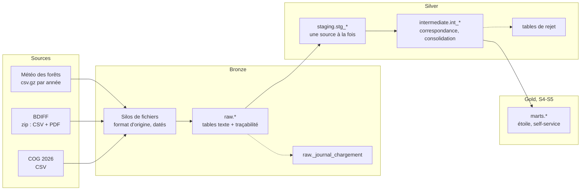

# Modèle de données cible v1 (18/11/2026)

- **Responsable :** Yakoub KEBAILI (pipeline et modèle) · **Relecture :** Melissa DJABELLA (cheffe de projet), Lynda LAZRI (qualité et conformité)
- **Périmètre :** étapes 6 et 7 du cadrage (extraction en couches, consolidation multi-sources). Le document couvre les couches **bronze** et **silver**. La couche **gold** (étoile, historisation, self-service) est seulement située ici : elle se conçoit en S4 et S5 (étapes 8 et 9).
- **Sources modélisées :** Météo des forêts 2024-2026, BDIFF Auvergne-Rhône-Alpes 2006-2025, COG 2026. Les chiffres cités ont été mesurés sur les fichiers extraits le 17/11/2026.
- **Règles de qualité et contrôles :** voir [regles-qualite.md](regles-qualite.md).

## 1. Vue d'ensemble

| Médaillon | Couche | Où | Rôle | Qui lit |
|---|---|---|---|---|
| Bronze | Silos | dossiers datés hors Git (ou bucket MinIO) | Fichiers tels que collectés, jamais modifiés | Pipeline |
| Bronze | Raw | schéma `raw` | Contenu des fichiers chargé tel quel (texte), avec sa provenance | Pipeline, responsable qualité |
| Silver | Staging | schéma `staging` | Une source à la fois : typer, renommer, normaliser, dédoublonner, minimiser | Équipe data |
| Silver | Intermédiaire | schéma `intermediate` | Correspondances, jointures entre sources, règles métier | Équipe data |
| Gold | Marts | schéma `marts` | Faits et dimensions pour les questions Q1 à Q4 (S4) | Utilisateurs (self-service) |

Trois règles s'appliquent à toutes les couches :
1. Raw ne transforme rien.
2. Chaque couche ne lit que la couche précédente.
3. Les règles métier vivent en intermédiaire, jamais en staging.

## 2. Bronze

### 2.1 Silos de fichiers

Chaque extraction est déposée dans un dossier daté, au format de collecte. Un dossier n'est jamais écrasé : on peut rejouer n'importe quel chargement passé. Les silos restent **hors du dépôt Git** : la licence BDIFF interdit de redistribuer les données, et Git n'est pas fait pour stocker des données.

| Source | Silo | Fichiers déposés tels quels | Extraction | Fréquence |
|---|---|---|---|---|
| Météo des forêts | `bronze/meteo_des_forets/<date_extraction>/` | `mdf_2024.csv.gz`, `mdf_2025.csv.gz`, `mdf_2026.csv.gz` | Complète | Quotidienne en saison (le fichier de l'année est réécrit), annuelle sinon |
| BDIFF | `bronze/bdiff/<date_extraction>/` | Zip du formulaire : `Incendies.csv`, `Mention légales.pdf`, `Définitions.pdf` | Complète, par région | Annuelle (année N-1) |
| COG | `bronze/cog/2026/` | `v_commune_2026.csv`, `v_mvt_commune_2026.csv`, `v_departement_2026.csv` | Complète | Annuelle (millésime) |
| BD Forêt V2 | `bronze/bd_foret_v2/69/` | Format non vérifié (Shapefile attendu) | Non faite | Pas de mise à jour régulière |
| Interventions SDMIS | `bronze/sdmis/` | Fichier demandé, non reçu | — | — |

**Pourquoi une extraction complète :** les volumes sont petits (35 616 lignes pour la Météo des forêts, 4 072 pour la BDIFF, 37 496 pour les communes du COG national). Aucune source ne fournit de marqueur de modification fiable. Le fichier Météo des forêts de l'année en cours est réécrit chaque jour. Le mode incrémental n'apporterait que ses angles morts : modifications rétroactives, arrivées tardives, suppressions.

### 2.2 Tables raw

Une table par source logique. Toutes les colonnes sont en texte, avec les noms d'origine et les valeurs inchangées. Cinq colonnes techniques sont ajoutées à chaque ligne : `_id_chargement`, `_fichier_source`, `_empreinte_fichier` (SHA-256), `_ligne_source`, `_date_chargement`.

| Table | Contenu | Particularité de lecture |
|---|---|---|
| `raw.mdf_bulletins` | Les 3 fichiers annuels | Séparateur `,` en 2024-2025 et `;` en 2026. La colonne du libellé s'appelle `nom_dep` en 2024 et `dep_nom` en 2025-2026 : les deux colonnes existent, chaque fichier remplit la sienne. |
| `raw.bdiff_incendies` | Les 24 colonnes de `Incendies.csv` | Les 3 premières lignes sont des métadonnées. Elles ne vont pas dans la table, mais le nombre d'incendies annoncé (4 072) et les critères de sélection sont écrits au journal. |
| `raw.cog_communes` | `v_commune_2026.csv` | — |
| `raw.cog_mouvements` | `v_mvt_commune_2026.csv` | — |
| `raw.cog_departements` | `v_departement_2026.csv` | 101 départements, dont 5 en outre-mer |

`raw.bdiff_incendies` contient encore les colonnes décès et bâtiments, qui sont des informations sensibles sur des personnes. L'accès à la couche raw est donc réservé au pipeline et à la responsable qualité. Ces colonnes disparaissent en staging (section 5).

### 2.3 Journal de chargement

`raw._journal_chargement` contient une ligne par fichier traité, succès compris.

| Colonne | Contenu |
|---|---|
| `id_chargement`, `source`, `fichier` | Identification |
| `empreinte_sha256`, `taille_octets` | Reconnaître un fichier déjà chargé, même renommé |
| `lignes_annoncees` | Nombre déclaré par la source (BDIFF : ligne 2 du fichier) |
| `lignes_lues`, `lignes_inserees`, `lignes_rejetees` | Réconciliation : lues = insérées + rejetées |
| `debut`, `fin`, `statut`, `message` | Statut : succès, échec ou ignoré (déjà chargé), avec le message d'erreur |

Deux règles :
- une empreinte déjà présente au journal fait ignorer le fichier ;
- un succès qui insère 0 ligne déclenche une alerte.

### 2.4 Idempotence

Un chargement rejoué ne doit rien doubler. Pour cela :
- **Remplacement par fichier**, dans une transaction : on supprime de la table raw les lignes du même `_fichier_source`, puis on les réinsère.
- **Dédoublonnage en staging**, en seconde garde : une seule ligne par clé naturelle, la plus récemment chargée.

La preuve se fait en comptant : charger, compter, recharger les mêmes fichiers, recompter. Les nombres attendus sont 35 616 lignes pour la Météo des forêts et 4 072 pour la BDIFF ; pour le COG, le nombre de lignes du fichier (test Q-PIP-01).

## 3. Silver : staging

Une source à la fois. On type, on renomme en `snake_case` français, on harmonise les formats, on dédoublonne et on supprime les champs écartés par le [tableau de minimisation](../sources/minimisation.md). Aucune jointure, aucune règle métier.

### 3.1 `staging.stg_mdf__bulletins`

**Grain :** un département × un bulletin émis. **Clé :** (`code_departement`, `date_emission`). **Lignes attendues :** 35 616.

| Colonne | Type | Origine | Transformation |
|---|---|---|---|
| `code_departement` | texte (2) | `num_dep` | Complété à 2 caractères (`1` devient `01`). `2A` et `2B` sont inchangés. |
| `horodatage_emission_utc` | horodatage UTC | `date` | Lu en ISO 8601 (`Z` = UTC) |
| `date_emission` | date | `date` | Date en heure de Paris |
| `niveau_j1`, `niveau_j2` | entier (1 à 4) | `niveau_j1`, `niveau_j2` | Conversion de type |
| `millesime_fichier` | entier | nom du fichier | 2024, 2025 ou 2026 |

**Écartés :** `nom_dep` et `dep_nom`. Le libellé du COG fait foi.

### 3.2 `staging.stg_bdiff__feux`

**Grain :** un feu. **Clé :** `id_feu_bdiff` (`Année`-`Numéro`, par exemple `2006-5296`). **Lignes attendues :** 4 072.

| Colonne | Type | Origine | Transformation |
|---|---|---|---|
| `id_feu_bdiff` | texte | `Année`, `Numéro` | Concaténation |
| `annee`, `numero_fiche` | entier | `Année`, `Numéro` | Conversion de type |
| `code_departement` | texte (2) | `Département` | — |
| `code_commune_origine` | texte (5) | `Code INSEE` | Gardé tel que saisi : c'est le code de l'année du feu, pas forcément celui du COG 2026 |
| `horodatage_alerte` | horodatage sans fuseau | `Date de première alerte` | Heure légale française supposée, **non vérifiée** (`Définitions.pdf` pas encore relu) |
| `date_alerte` | date | `Date de première alerte` | Partie date |
| `surface_parcourue_m2` | entier | `Surface parcourue (m2)` | Unité gardée : m² |
| `surface_foret_m2` | entier | `Surface forêt (m2)` | Vide gardé vide (316 feux) : un vide n'est pas un 0 |
| `precision_surfaces` | texte | `Précision des surfaces` | Valeurs : Estimées, Mesurées, vide |
| `type_peuplement_code` | texte | `Type de peuplement` | Codes 1 à 6, libellés **non vérifiés** |
| `cause_nature` | texte | `Nature` | 5 valeurs. Gardé sous condition (voir minimisation). |
| `precision_donnee` | texte | `Précision de la donnée` | Signale les 122 fiches partielles ou non valides |

**Écartés :** `Nom de la commune` (le COG fait foi), les 8 autres colonnes de surfaces ventilées, et les 4 colonnes décès et bâtiments.

### 3.3 Référentiel COG

| Table | Grain et clé | Colonnes | Remarque |
|---|---|---|---|
| `stg_cog__communes` | Une commune au 01/01/2026, clé `code_commune` | `code_commune`, `code_departement`, `code_region`, `code_ctcd` (69D ou 69M), `libelle_commune`, `millesime_cog` | Filtre `TYPECOM = 'COM'` : les arrondissements de Lyon et les communes déléguées ne sont pas au grain |
| `stg_cog__departements` | Un département, clé `code_departement` | `code_departement`, `code_region`, `libelle_departement` | 101 lignes. La Météo des forêts couvre les 96 de la métropole. |
| `stg_cog__mouvements` | Un mouvement | `mod`, `date_effet`, `typecom_avant`, `code_commune_avant`, `typecom_apres`, `code_commune_apres` | Les deux `typecom` s'ajoutent au tableau de minimisation : ils servent à ne retenir que les communes de destination. |

## 4. Silver : intermédiaire (consolidation)

### 4.1 Conflits entre sources et résolution

| Conflit | Constat | Résolution |
|---|---|---|
| Noms | `num_dep`, `Département` et `DEP` désignent la même chose | Un nom cible : `code_departement` |
| Formats | `1` contre `01` ; ISO 8601 `…T16:00:00Z` contre `AAAA-MM-JJ hh:mm:ss` ; séparateurs `,` et `;` | Normalisé en staging |
| Fuseaux | Météo des forêts en UTC ; BDIFF sans fuseau | Comparaison en dates locales (Europe/Paris) |
| Sens des dates | Météo des forêts : `date` est la date d'**émission** ; le niveau vaut pour le lendemain (J+1) ou le surlendemain (J+2) | `jour_cible` calculé en intermédiaire |
| Codes | Codes commune de l'année du feu contre COG 2026 ; département 69 = Rhône (69D) + Métropole (69M) | Table de passage (4.3) ; `code_ctcd` porté par la commune |
| Grain | Feu × commune (BDIFF) contre département × jour (Météo des forêts) | Jointure au grain le plus gros : département × jour |
| Unités | Surfaces en m² (BDIFF seule) ; niveaux ordinaux de 1 à 4, non additifs | m² gardés jusqu'à la couche gold ; un niveau ne se somme ni ne se moyenne |

### 4.2 Clés

| Clé | Sorte | Portée | Usage |
|---|---|---|---|
| `code_commune` (COG) | Naturelle | Universelle | Jointure feux × territoire |
| `code_departement` | Naturelle | Universelle | Jointure feux × niveau de danger |
| `id_feu_bdiff` | Métier | BDIFF | Identité d'un feu dans la BDIFF |
| (`code_departement`, `date_emission`) | Naturelle composée | Météo des forêts | Identité d'un bulletin |
| `feu_sk` | De substitution | Entrepôt | Hachage de (`source`, `id_source`). Un feu présent dans la BDIFF et dans le fichier SDMIS n'a de clé dans aucune des deux sources. |

Ordre de recherche : d'abord le code exact, puis le code passé par la table de passage. **Jamais un libellé**, et pas de rapprochement approché : il n'est pas nécessaire, puisque 100 % des codes sont résolus.

### 4.3 Table de passage des communes : `int_territoire__passage_communes`

**Grain :** un code commune rencontré dans une source → un code COG 2026.

**Colonnes :** `code_commune_origine`, `code_commune_cog2026`, `regle` (`identique` ou `mouvement`), `mods_appliques`.

**Construction :**
- un code présent au COG 2026 donne la règle `identique` ;
- sinon on suit les mouvements, en ne retenant que les destinations de type `COM`, jusqu'à atteindre un code présent en 2026.

La table est générée depuis le COG : pas de `CASE WHEN` écrit à la main. Elle est versionnée par le millésime COG.

**Mesuré :**
- 25 codes absents du COG 2026, portés par 48 feux. 22 sont résolus par une création de commune nouvelle (MOD 32), 3 par une création puis une suppression de commune déléguée (MOD 32 et 35).
- Chaque code mène à **une seule** commune. La cardinalité est donc **plusieurs pour un** (fusions) : agréger à la commune 2026 est sûr, aucune répartition n'est nécessaire.
- Exemple dans le Rhône : 69211 (Saint-Jean-d'Ardières) devient 69019 (Belleville-en-Beaujolais, 69D).
- Une fois rattachés, les 62 feux du Rhône se répartissent en 53 dans le Rhône (69D) et 9 dans la Métropole (69M).

**Limite assumée :** le rattachement au territoire 2026 répond à la question « où, avec les communes d'aujourd'hui ». Le code d'origine est conservé, pour pouvoir historiser le territoire (SCD de type 2) en S5.

### 4.4 Modèles intermédiaires

| Modèle | Grain | Construction | Lignes attendues |
|---|---|---|---|
| `int_territoire__communes` | Une commune 2026 | Communes + libellé du département + `perimetre_sdmis` (département 69, 69D et 69M) | Toutes les communes 2026 (4 025 dans la région 84) |
| `int_bdiff__feux_rattaches` | Un feu | `stg_bdiff__feux` en jointure externe vers la table de passage, + `code_commune_cog2026`, `code_ctcd`, `feu_sk`, `source = 'BDIFF'` | 4 072 rattachés, 0 rejeté |
| `int_bdiff__feux_rejets` | Un feu non rattaché | Lignes sans correspondance, avec leur motif, leur fichier et leur ligne d'origine | 0 au 17/11 |
| `int_mdf__danger_jour` | Un département × un jour cible | J+1 de la veille et J+2 de l'avant-veille, côte à côte (survivance en 4.5) | 35 904 (96 × 374 jours cibles) |
| `int_feux__danger` | Un feu | Feu en jointure externe vers le niveau du jour d'alerte, sur (`code_departement`, `date_alerte` = `jour_cible`), + `statut_bulletin` | 4 072 |

`statut_bulletin` prend trois valeurs : `niveau disponible`, `hors saison du bulletin`, `année sans bulletin` (avant 2024). Un feu sans niveau **reste** dans la table : ces feux sont précisément l'objet de Q3.

**Mesuré (2024-2025, seule période commune aux deux sources) :**
- 337 feux dans la région. 225 ont un niveau J+1 (66,8 %), 112 surviennent hors de la saison du bulletin.
- Le Rhône ne compte que 3 feux sur ces deux années, tous avec un niveau. Cela confirme le manque M-1 : un seuil propre au Rhône ne peut pas reposer sur la seule BDIFF.

### 4.5 Survivance : une règle par attribut

| Attribut | Sources | Règle | Valeur retenue |
|---|---|---|---|
| Niveau de danger d'un jour | J+1 de la veille, J+2 de l'avant-veille | Vérité à date : J+1 fait foi. J+2 sert à l'analyse de sensibilité. **Pas de comblement :** un jour sans J+1 a un niveau vide. | `niveau_reference = niveau_j1` |
| Commune d'un feu | Code BDIFF, COG 2026 | Code COG 2026 via la table de passage ; le code d'origine est conservé | `code_commune_cog2026` |
| Libellé commune et département | BDIFF, Météo des forêts, COG | Le COG fait foi, jamais un libellé de source | Libellé COG |
| Appartenance 69D / 69M | COG | `CTCD` du COG | `code_ctcd` |
| Existence, date et surface d'un feu | BDIFF, SDMIS (attendu) | BDIFF jusqu'en 2025. Le SDMIS primera pour le 69 s'il est plus complet, et l'écart sera documenté ([matrice](../sources/matrice.md)). | Valeur BDIFF, avec `source` |

Chaque valeur retenue garde sa source : colonnes `source`, `date_emission_j1` et `regle`.

Avec la règle « pas de comblement », chaque saison compte un jour sans J+1 (le surlendemain du dernier bulletin) et un jour sans J+2 (le lendemain du premier bulletin). Cela fait 288 couples département × jour de chaque type sur les trois saisons.

### 4.6 Rapprochement BDIFF ↔ SDMIS (à appliquer à réception du fichier)

Aucune clé n'est commune aux deux sources. La règle est fixée dès maintenant pour ne pas la choisir au vu des résultats.

1. **Blocage :** même commune COG 2026, et date d'alerte à ± 1 jour.
2. **Règle sûre :** même commune, même date et surface proche : c'est le même feu. Le seuil de « surface proche » part de ± 20 %, valeur provisoire à régler sur un échantillon vérifié à la main.
3. **Zone grise** (date à ± 1 jour, ou surfaces plus éloignées) : revue manuelle. Elle est faisable vu les volumes : 62 feux BDIFF en 20 ans dans le 69.
4. **Sinon :** deux feux distincts.

| Erreur | Effet sur la décision | Choix |
|---|---|---|
| Faux positif (deux feux fusionnés) | Des feux disparaissent : feux sous le seuil sous-estimés, secteurs sous-dotés | **L'erreur la plus coûteuse** (un feu manqué). Seuil de fusion automatique haut. |
| Faux négatif (un feu compté deux fois) | Feux surestimés, renforcement plus fréquent que nécessaire | Coût budgétaire, mesuré et documenté |

La précision et le rappel seront mesurés sur un échantillon vérifié à la main, et écrits avec le seuil retenu.

### 4.7 Rejets et non-perte

Une ligne qui ne se rapproche pas n'est ni supprimée ni devinée. Elle va dans une table de rejet avec son motif. Après chaque consolidation, les nombres de lignes **et** les sommes de surfaces sont réconciliés avec la staging. Les tests sont décrits dans [regles-qualite.md](regles-qualite.md), section 3.

## 5. RGPD, licences et accès par couche

| Couche | Données personnelles | Mesure |
|---|---|---|
| Silos et raw | BDIFF : décès et bâtiments détruits, qui permettent d'isoler une personne à la commune. SDMIS (attendu) : les champs listés dans la minimisation. | Accès réservé au pipeline et à la responsable qualité |
| Staging | Aucune : les colonnes décès et bâtiments sont supprimées. Pour le SDMIS, l'identifiant d'intervention sera pseudonymisé par hachage avec clé secrète (HMAC SHA-256), clé conservée hors du dépôt. | Test bloquant Q-RGPD-01 |
| Intermédiaire | Aucune, seulement des pseudonymes | Test bloquant Q-RGPD-01 |
| Gold | Aucune. La cause d'un feu n'est jamais affichée à la commune quand celle-ci compte moins de 3 feux (risque de ré-identification). | Règle à implémenter en S4 |

**Droits d'accès (protection dès la conception, art. 25) :**
- `role_pipeline` écrit dans toutes les couches ;
- `role_equipe_data` lit staging et intermédiaire ;
- `role_lecteur` lit **uniquement** `marts` : c'est le rôle des utilisateurs du self-service.

**Licences à respecter en aval :**
- BDIFF : pas d'usage commercial, pas de modification présentée comme la donnée d'origine. Toute restitution cite `bdiff.agriculture.gouv.fr` et indique que les droits de reproduction sont réservés.
- Météo des forêts : Licence Ouverte 2.0, mention « Météo-France ».
- COG : licence **non vérifiée**.

## 6. Couche gold et self-service (S4-S5, non construite)

Ce qui est déjà fixé :
- la couche gold lira uniquement l'intermédiaire ;
- c'est le seul schéma ouvert aux utilisateurs ;
- elle servira les questions Q1 à Q4 de la [matrice](../sources/matrice.md).

Le grain des faits, l'étoile, la matrice en bus et la dimension territoire historisée se décident en S4 et S5. L'outil de restitution se choisit en UE01.C.

## 7. Choix techniques

| # | Choix | Alternative écartée | Justification | Statut |
|---|---|---|---|---|
| 1 | ELT avec dbt | ETL | Une règle fausse se corrige et se rejoue sans ré-extraire ; c'est l'outil du cours | Retenu |
| 2 | Entrepôt PostgreSQL, un schéma par couche | DuckDB | Droits par rôle et par schéma, accès simultanés pour le self-service, connecteurs BI. DuckDB (un seul fichier) gère mal les droits et les accès concurrents. | Proposé, à valider par Yakoub |
| 3 | Silos en dossiers datés hors Git (ou MinIO) | Données versionnées dans le dépôt | Licence BDIFF, volume, rejeu de tout chargement passé | Proposé |
| 4 | Extraction complète | Incrémentale | Petits volumes, pas de marqueur de modification fiable | Retenu |
| 5 | Idempotence : remplacement par fichier, puis dédoublonnage en staging | Insertion simple | Un fichier rechargé ne double rien ; le journal le prouve | Retenu |
| 6 | Feux × danger joints au grain département × jour | Commune × jour | Le niveau n'existe qu'au département | Retenu |
| 7 | Niveau de référence J+1, sans comblement | Moyenne de J+1 et J+2, ou J+2 en secours | Vérité à date ; un niveau n'est jamais deviné | Retenu |
| 8 | Territoire du COG 2026 + code d'origine conservé | Code d'origine seul | Jointure complète dès maintenant ; l'historisation reste possible en S5 | Retenu |
| 9 | Non rapprochés en table de rejet | Suppression ou devinette | Totaux réconciliables, erreurs retrouvables | Retenu |

## 8. Limites et points ouverts

| Point | Effet | Suite |
|---|---|---|
| BD Forêt V2 pas encore ouverte | Pas de dénominateur de surface boisée (M-8) | Ajouter `stg_bd_foret__formations` après ouverture du fichier |
| Fichier SDMIS non reçu | Pas de feux 2026, Rhône incomplet (M-1, M-2) | Le modèle est prêt à l'accueillir (4.6, `feu_sk`) |
| `Définitions.pdf` non relu | Fuseau de l'heure d'alerte et libellés du type de peuplement non vérifiés | Relecture par Melissa |
| BDIFF extraite pour la région seulement | La comparaison nationale (Q4) est impossible côté feux | Refaire l'extraction département par département |
| Licence du COG non vérifiée | — | Vérifier les conditions sur insee.fr |
