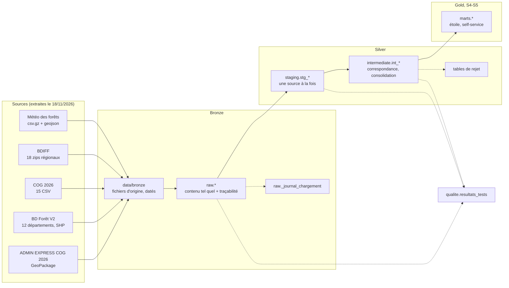

# Modèle de données cible et entrepôt v1 (18/11/2026)

- **Responsable :** Yakoub KEBAILI (pipeline et modèle) · **Relecture :** Melissa DJABELLA (cheffe de projet), Lynda LAZRI (qualité et conformité)
- **Périmètre :** étapes 6 et 7 du cadrage (extraction en couches, consolidation multi-sources). Les couches **bronze** et **silver** sont construites. La couche **gold** (étoile, historisation, self-service) est seulement située : elle se conçoit en S4 et S5 (étapes 8 et 9).
- **La base :** un seul fichier DuckDB, `data/entrepot/feux_de_foret.duckdb` (1 028 Mo), qui regroupe les cinq sources téléchargées. Il est construit par `pipeline/construire_entrepot.py` à partir des silos `data/bronze/`. Les données ne sont pas dans Git (section 6).
- **Règles de qualité et résultats :** voir [regles-qualite.md](regles-qualite.md).

## 1. Vue d'ensemble



| Médaillon | Couche | Où | Rôle | Tables |
|---|---|---|---|---|
| Bronze | Silos | `data/bronze/<source>/<extraction>/` | Fichiers tels que collectés, jamais modifiés, avec `SHA256SUMS.txt` | 40 fichiers, 798 Mo |
| Bronze | Raw | schéma `raw` | Contenu des fichiers en texte (géométries en WKB), avec sa provenance | 25 + journal + rejets |
| Silver | Staging | schéma `staging` | Une source à la fois : typer, renommer, normaliser, dédoublonner, minimiser | 11 tables + 2 vues |
| Silver | Intermédiaire | schéma `intermediate` | Correspondances, jointures entre sources, règles métier | 9 |
| Qualité | — | schéma `qualite` | Résultat de chaque règle à chaque exécution | 1 (+ exécution courante) |
| Gold | Marts | schéma `marts` | Faits et dimensions pour Q1 à Q4 (S4) | — |

Trois règles s'appliquent à toutes les couches :
1. Raw ne transforme rien.
2. Chaque couche ne lit que la couche précédente.
3. Les règles métier vivent en intermédiaire, jamais en staging.

## 2. Bronze

### 2.1 Silos

Chaque extraction est déposée dans un dossier daté, au format de collecte. Un dossier n'est jamais écrasé, ce qui permet de rejouer n'importe quel chargement passé. Le script lit le dossier le plus récent de chaque source.

| Source | Silo | Contenu | Remarque |
|---|---|---|---|
| Météo des forêts | `meteo_des_forets/2026-11-18/` | `mdf_2024.csv.gz` à `mdf_2026.csv.gz`, contours des 96 départements (geojson), exemple d'une journée et PDF de présentation | Toutes les ressources du jeu data.gouv.fr |
| BDIFF | `bdiff/2026-11-18/` | 18 zips (13 régions de métropole et 5 d'outre-mer), feux 2006-2025, chacun avec `Incendies.csv`, `Mention légales.pdf` et `Définitions.pdf` | Extraction par région : le serveur garde la sélection en session et l'extraction nationale échoue |
| COG | `cog/2026/` | `cog_ensemble_2026_csv.zip` : les 15 fichiers du millésime, communes depuis 1943 comprises | National |
| BD Forêt V2 | `bd_foret_v2/2026-11-18/` | 12 archives 7z, une par département d'Auvergne-Rhône-Alpes, + `md5_ign.txt` | md5 IGN vérifiés |
| ADMIN EXPRESS COG | `admin_express_cog/2026/` | Édition 2026, métropole, Lambert 93, pleine précision (GeoPackage 7z) | Contours des communes pour le géotraitement |
| Interventions SDMIS | — | Demandé, non reçu | Le modèle est prêt à l'accueillir (4.5) |

**Extraction complète** pour toutes les sources : les volumes sont petits et aucune source ne fournit de marqueur de modification fiable.

### 2.2 Raw

Toutes les colonnes sont en texte, avec les noms et les valeurs d'origine. Les géométries sont stockées telles que livrées, en WKB (`geometrie_wkb`, Lambert 93). Chaque ligne porte six colonnes de traçabilité : `_id_chargement`, `_fichier_source`, `_fichier_logique`, `_empreinte_fichier` (SHA-256), `_ligne_source`, `_date_chargement`.

| Tables | Lignes | Particularité |
|---|---|---|
| `mdf_bulletins`, `mdf_departements_geo` | 35 616 ; 96 | Séparateur `,` ou `;` détecté par fichier ; `nom_dep` et `dep_nom` coexistent |
| `bdiff_incendies`, `bdiff_notes_campagnes` | 52 811 ; 2 | Ligne d'en-tête repérée (2, 3 ou 6 lignes de métadonnées selon le fichier). Les notes « A noter » de la source (Pyrénées-Atlantiques : 2010 données perdues, 2011 aucune donnée) sont gardées. |
| `cog_*` (15 tables) | 37 496 communes, 13 734 mouvements… | Tous les fichiers du millésime |
| `bd_foret_formations`, `bd_foret_metadonnees` | 230 127 polygones ; 12 | Dates de la réalité décrite lues dans les métadonnées XML |
| `admin_express_commune`, `_departement`, `_region`, `_arrondissement_municipal` | 34 746 ; 96 ; 13 ; 45 | Avec population et géométrie |
| `_journal_chargement`, `_rejets_chargement` | — | Une ligne par fichier traité, succès compris ; lignes illisibles avec leur motif |

`raw.bdiff_incendies` contient encore les colonnes décès et bâtiments, qui sont des informations sensibles. Elles disparaissent en staging (section 5).

### 2.3 Idempotence et journal

- Un fichier dont l'empreinte est déjà au journal avec le statut « succès » est **ignoré**.
- Un fichier rechargé **remplace ses propres lignes**, repérées par `_fichier_logique`, dans une transaction.
- Le staging garde une ligne par clé naturelle, la plus récemment chargée.
- **Preuve (Q-PIP-01) :** l'option `--idempotence` recharge tout une seconde fois en forçant, puis compare les comptes des 25 tables raw. Résultat au 18/11 : aucun écart. Une exécution normale relancée ignore les 83 chargements déjà faits.

## 3. Silver : staging

| Table | Grain, clé | Ce qui est fait |
|---|---|---|
| `stg_mdf__bulletins` | Département × bulletin émis ; (`code_departement`, `date_emission`) | Code complété à 2 caractères ; horodatage UTC ; date d'émission à l'heure de Paris ; niveaux en entier |
| `stg_bdiff__feux` | Un feu ; `id_feu_bdiff` (`Année-Numéro`) | Types, noms en français ; libellé du type de peuplement (ordre de `Définitions.pdf`) ; dédoublonnage. Écartés : libellé de commune, 8 surfaces ventilées, 4 colonnes décès et bâtiments. |
| `stg_bdiff__notes_campagnes` | Département × année signalé par la source | — |
| `stg_cog__codes_commune`, `stg_cog__communes` | Tous les types de code ; communes (`TYPECOM = COM`) | `code_ctcd` distingue 69D et 69M |
| `stg_cog__departements`, `stg_cog__regions`, `stg_cog__mouvements` | — | — |
| `stg_admin_express__communes` | Une commune | Population et date du recensement |
| `stg_bd_foret__formations` | Un polygone ; `id_formation` | Catégorie : **forêt** (codes FF, FO, FP), **lande**, **formation herbacée** |
| `stg_bd_foret__metadonnees` | Un département | Édition, début et fin de la réalité décrite |
| `stg_bd_foret__geometries`, `stg_admin_express__geometries_communes` | **Vues** sur raw | Les géométries (1,5 Go) ne sont pas recopiées |

**Dates de la BD Forêt :** la réalité décrite va de 2007 à 2014 selon les départements. Pour le Rhône, les métadonnées donnent une fin (26/07/2010) antérieure au début (20/12/2010) : c'est l'objet de la règle Q-BDF-13.

## 4. Silver : intermédiaire (consolidation)

### 4.1 Conflits entre sources et résolution

| Conflit | Constat | Résolution |
|---|---|---|
| Noms | `num_dep`, `Département`, `DEP`, `code_insee_du_departement` | Un nom cible : `code_departement` |
| Formats | `1` contre `01` ; ISO 8601 en UTC contre date locale ; séparateurs `,` et `;` | Normalisé en staging |
| Fuseaux | Météo des forêts en UTC ; BDIFF sans fuseau (l'heure est celle de l'arrivée de l'alerte au CODIS, fuseau non précisé) | Comparaison en dates locales (Europe/Paris) |
| Sens des dates | Météo des forêts : `date` est la date d'**émission** ; le niveau vaut pour J+1 et J+2 | `jour_cible` calculé |
| Codes | Code commune de l'année du feu contre COG 2026 ; 69 = Rhône (69D) + Métropole (69M) | Table de passage (4.2) ; `code_ctcd` |
| Grain | Feu × commune, département × jour, polygone de végétation | Jointure au grain commun (département × jour ; commune) |
| Unités | Surfaces en m² ; niveaux ordinaux de 1 à 4, non additifs | m² gardés ; un niveau ne se somme ni ne se moyenne |

Les clés de jointure sont naturelles : code commune et code département (Insee). Le feu reçoit une clé de substitution, `feu_sk` (hachage de `source|id`), pour accueillir plus tard le fichier SDMIS. On ne joint **jamais sur un libellé**.

### 4.2 Table de passage des communes : `int_territoire__passage_communes`

Elle est générée depuis le COG, jamais écrite à la main. Pour chaque code commune rencontré dans la BDIFF :
- s'il existe au COG 2026, règle `identique` ;
- si c'est un arrondissement municipal, règle `arrondissement municipal` (commune parente) ;
- sinon, on suit les mouvements vers les communes de type `COM` jusqu'à un code présent en 2026 ;
- s'il reste plusieurs communes possibles, le cas est **ambigu**, et sans aucune, il est **introuvable** : dans les deux cas, le feu est rejeté, jamais deviné.

**Résultat national :**
- 9 675 codes : 9 478 identiques, 196 résolus par les mouvements, 1 introuvable.
- Chaque code résolu mène à une seule commune. La cardinalité est **plusieurs pour un** (fusions) : agréger à la commune 2026 est sûr.
- 475 feux sont rattachés par un mouvement. Exemple dans le Rhône : 69211 (Saint-Jean-d'Ardières) devient 69019 (Belleville-en-Beaujolais).
- **Rejet :** le code 83999, une « commune inconnue » saisie dans le Var, porte 12 feux (801 ha), mis en table de rejet.

### 4.3 Modèles intermédiaires

| Modèle | Grain | Lignes |
|---|---|---|
| `int_territoire__communes` | Commune 2026 + département, région, `code_ctcd`, `perimetre_sdmis`, population | 34 875 |
| `int_bdiff__feux_rattaches` | Feu rattaché à sa commune 2026, avec `feu_sk` et la règle utilisée | 52 798 |
| `int_bdiff__feux_rejets` | Feu non rattaché, avec son motif | 12 |
| `int_mdf__danger_jour` | Département × jour cible : J+1 de la veille et J+2 de l'avant-veille | 35 904 |
| `int_feux__danger` | **Tous** les feux (rattachés ou non à une commune) × niveau du jour d'alerte, avec `statut_bulletin` | 52 810 |
| `int_bd_foret__formation_commune` | Polygone de végétation × commune (surface intersectée) | 284 161 |
| `int_territoire__vegetation_commune` | Commune d'Auvergne-Rhône-Alpes : surfaces de forêt, de lande et de formation herbacée, taux de boisement, dates de la BD Forêt | 4 025 |
| `int_bd_foret__controle_geotraitement` | Département : surface des polygones contre somme des morceaux | 12 |

`statut_bulletin` vaut `niveau disponible`, `hors saison du bulletin`, `année sans bulletin` (avant 2024) ou `département hors Météo des forêts` (outre-mer). Un feu sans niveau **reste** dans la table : ces feux sont l'objet de Q3. Un feu non rattaché à une commune reste compté à l'échelle de son département.

**Mesuré :**
- 2024-2025, France : 3 908 feux, dont 2 612 avec un niveau (66,8 %) et 1 252 hors saison du bulletin.
- Auvergne-Rhône-Alpes : 337 feux, dont 225 avec un niveau ; Rhône : 3 feux. Le manque M-1 demeure : la BDIFF ne suffit pas pour un seuil propre au Rhône.
- Végétation d'Auvergne-Rhône-Alpes : forêt 38,4 % du territoire, lande 2,7 %. Rhône 26,3 % (69D : 28,8 %, 69M : 13,5 %) ; Ardèche 59,1 % ; Drôme 53,5 %.

### 4.4 Survivance : une règle par attribut

| Attribut | Sources | Règle |
|---|---|---|
| Niveau de danger d'un jour | J+1 de la veille, J+2 de l'avant-veille | J+1 fait foi (vérité à date). J+2 sert à l'analyse de sensibilité. Pas de comblement : un jour sans J+1 a un niveau vide. |
| Commune d'un feu | Code BDIFF, COG 2026 | Code COG 2026 via la table de passage ; le code d'origine est conservé |
| Libellés commune et département | BDIFF, Météo des forêts, COG, ADMIN EXPRESS | Le COG fait foi |
| Population | ADMIN EXPRESS | Seule source |
| Existence, date et surface d'un feu | BDIFF, SDMIS (attendu) | BDIFF jusqu'en 2025 ; le SDMIS primera pour le 69 s'il est plus complet, et l'écart sera documenté |

### 4.5 Rapprochement BDIFF ↔ SDMIS (à réception du fichier)

Règle fixée d'avance, pour ne pas la choisir au vu des résultats :
1. **Blocage :** même commune 2026, date à ± 1 jour.
2. **Même feu :** même commune, même date, surface proche. Seuil de départ : ± 20 %, à régler sur un échantillon vérifié à la main.
3. **Zone grise :** revue manuelle (62 feux BDIFF en 20 ans dans le 69).
4. **Sinon :** deux feux distincts.

Le faux positif (deux feux fusionnés, donc des feux manqués) coûte plus que le faux négatif (un feu compté deux fois) : le seuil de fusion automatique est haut. La précision et le rappel seront mesurés et écrits avec le seuil.

### 4.6 Géotraitement de la végétation

L'intersection des polygones de la BD Forêt (12 départements) avec les communes d'ADMIN EXPRESS est calculée en Python (shapely), en lisant les géométries par les vues staging. Un polygone qui déborde sur un département voisin est découpé entre les communes concernées.

Contrôle Q-CONS-10 : en Haute-Savoie, 0,23 % de la surface (5,9 km²) ne tombe dans aucune commune française. Ce sont des polygones qui débordent sur la Suisse. Le défaut est connu et sans effet sur les taux communaux.

## 5. RGPD, licences et accès

| Couche | Données personnelles | Mesure |
|---|---|---|
| Silos et raw | BDIFF : décès et bâtiments détruits (peuvent isoler une personne à la commune) | Le fichier reste sur les postes de l'équipe, hors Git |
| Staging, intermédiaire | Aucune : colonnes supprimées en staging | Test bloquant Q-RGPD-01 sur le catalogue des colonnes |
| Gold | Aucune ; cause jamais affichée pour une commune de moins de 3 feux | Règle Q-RGPD-02, à écrire en S4 |

**Accès :** DuckDB est un fichier sans gestion de rôles. La protection repose donc sur la conception : aucune colonne personnelle après raw, ce que le test vérifie. Pour le self-service, la couche gold sera exportée seule dans un fichier distinct, ou dans un serveur PostgreSQL avec un rôle `lecteur` limité à `marts`. Ce choix se fera en S4.

**Licences en aval :**
- BDIFF : pas d'usage commercial ; citer `bdiff.agriculture.gouv.fr` et la mention « droits de reproduction réservés ».
- Météo des forêts : Licence Ouverte 2.0, « Météo-France ».
- COG : Licence Ouverte 2.0, « Source : Insee » (vérifié le 18/11 dans les mentions légales d'insee.fr).
- BD Forêt et ADMIN EXPRESS : Licence Ouverte 2.0, « IGN ».

## 6. Utiliser et reconstruire la base

**Ouvrir la base**, en lecture seule pour ne pas la bloquer pendant une reconstruction :
- DBeaver : nouvelle connexion DuckDB, puis choisir le fichier ;
- Python : `duckdb.connect("data/entrepot/feux_de_foret.duckdb", read_only=True)` ;
- en ligne de commande : `duckdb -readonly data/entrepot/feux_de_foret.duckdb`.

Le fichier est au format DuckDB 1.2 : il s'ouvre avec toute version 1.2 ou plus récente.

**Reconstruire** à partir des silos, en 3 à 6 minutes :
```bash
pip install -r pipeline/requirements.txt
python pipeline/construire_entrepot.py                # met à jour, ignore les fichiers déjà chargés
python pipeline/construire_entrepot.py --idempotence  # preuve Q-PIP-01
```
Le script s'arrête si une règle « bloquer » échoue : la couche suivante n'est pas alimentée. Il compacte ensuite la base.

**Vérifier l'intégrité :** `data/bronze/SHA256SUMS.txt` pour les silos, `data/entrepot/feux_de_foret.duckdb.sha256` pour la base livrée.

**Partager :** le dossier `data/` est exclu de Git par `.gitignore`. Il est transmis hors dépôt, ou reconstruit par chaque membre à partir des silos.

## 7. Choix techniques

| # | Choix | Alternative écartée | Justification |
|---|---|---|---|
| 1 | ELT : chargement brut, transformation dans la base | ETL | Une règle fausse se corrige et se rejoue sans ré-extraire |
| 2 | **DuckDB**, un fichier, un schéma par couche | PostgreSQL | Rien à installer sur les postes Windows ; un seul fichier qui regroupe tout ; SQL standard ; compatible dbt (`dbt-duckdb`) et DBeaver. Limite : pas de rôles (section 5). |
| 3 | Transformations en SQL dans un script Python | dbt dès maintenant | Le script porte le chargement des formats (zip, 7z, shapefile, GeoPackage) et le géotraitement. Les requêtes staging et intermédiaire se reprennent telles quelles en modèles dbt. |
| 4 | Silos datés dans `data/bronze`, hors Git | Données versionnées | Licence BDIFF, volume (798 Mo), rejeu de tout chargement passé |
| 5 | Extraction complète | Incrémentale | Petits volumes, pas de marqueur de modification fiable |
| 6 | Idempotence : empreinte au journal + remplacement par fichier + dédoublonnage en staging | Insertion simple | Prouvée par Q-PIP-01 |
| 7 | Géométries en WKB dans raw, exposées en vues staging | Géométries laissées dans les fichiers | Une seule base qui contient tout ; pas de copie de 1,5 Go |
| 8 | Feux × danger au grain département × jour | Commune × jour | Le niveau n'existe qu'au département |
| 9 | Niveau de référence J+1, sans comblement | Moyenne J+1/J+2, ou J+2 en secours | Vérité à date ; un niveau n'est jamais deviné |
| 10 | Territoire du COG 2026, code d'origine conservé | Code d'origine seul | Jointure complète ; historisation possible en S5 |
| 11 | Non rapprochés en table de rejet | Suppression ou devinette | Totaux réconciliés, erreurs retrouvables |

## 8. Limites et points ouverts

| Point | Effet | Suite |
|---|---|---|
| Fichier SDMIS non reçu | Pas de feux 2026 ; Rhône sous-représenté (M-1, M-2) | Modèle prêt (4.5, `feu_sk`) |
| BD Forêt limitée à Auvergne-Rhône-Alpes | Pas de taux de boisement pour comparer le Rhône à la France (Q4) | Télécharger les 84 autres départements (plusieurs Go) ou une statistique nationale de surface forestière : à décider |
| BD Forêt de 2007-2014 | La végétation a pu changer, et les catégories de surface de la BDIFF changent en 2023 | Écrit dans le rapport ; à reprendre avec l'historisation (S5) |
| Fuseau de l'heure d'alerte BDIFF non précisé | Faible effet : la jointure se fait au jour | Hypothèse : heure légale française |
| Libellés du type de peuplement | Déduits de l'ordre de la liste de `Définitions.pdf` | À confirmer auprès du producteur |
